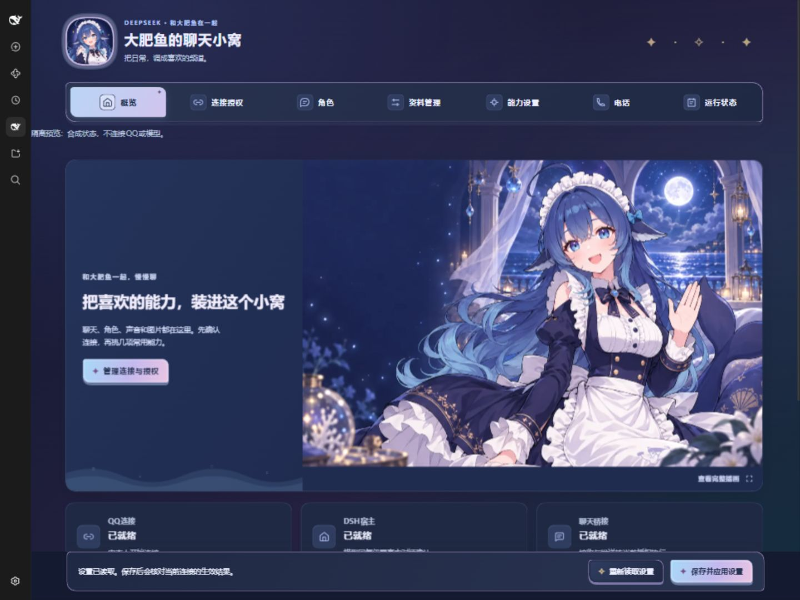
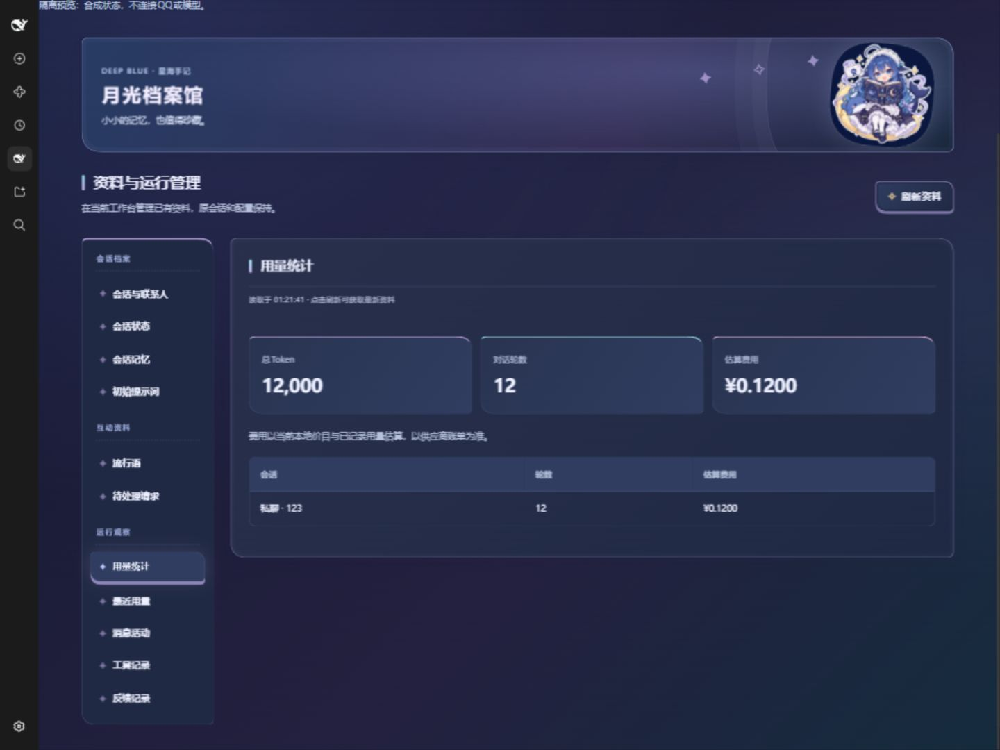
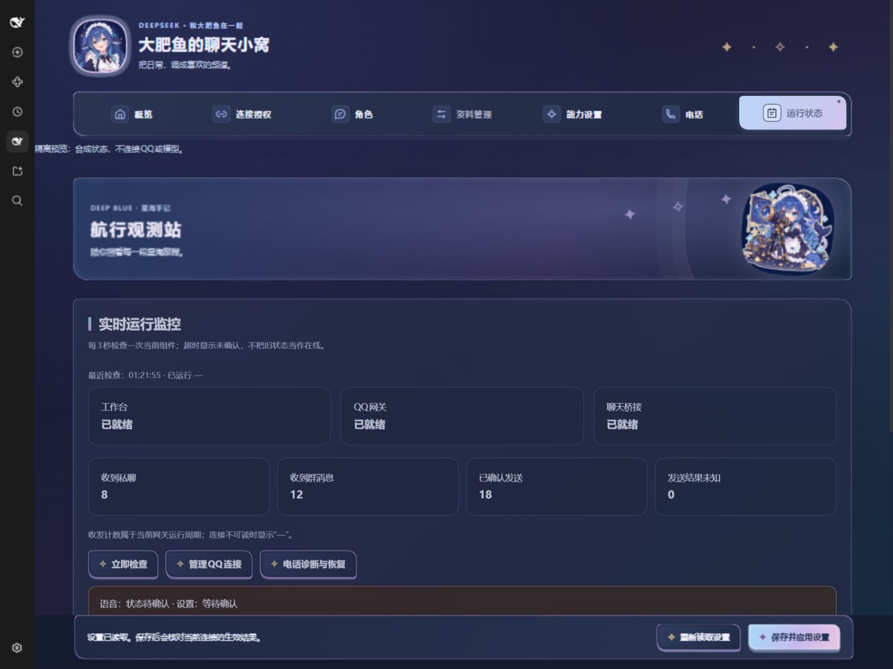
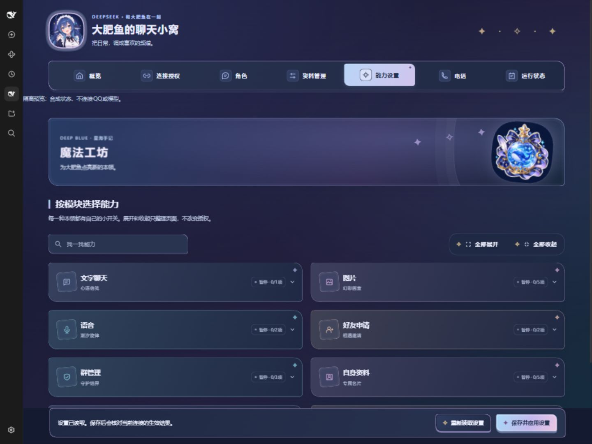
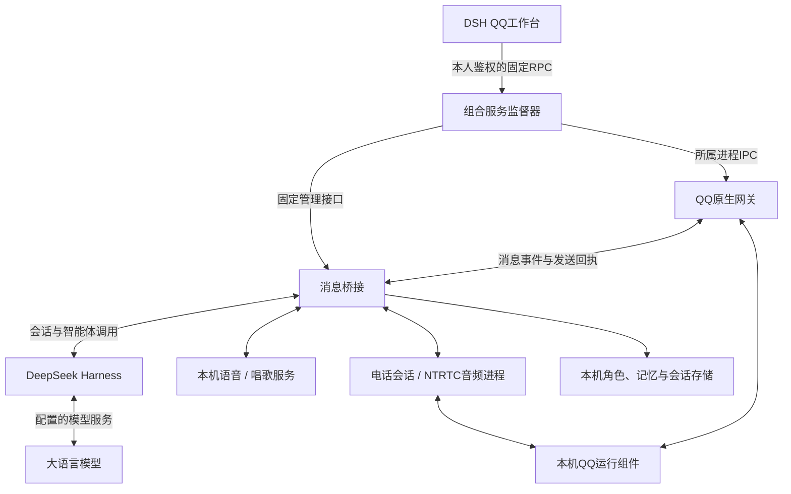

# 大肥鱼 · DeepSeek QQ

**把聊天、角色、声音和记忆，放进同一个星海小窝。**

面向 Windows 的 QQ 智能体工作台，以 DeepSeek Harness 为智能体宿主，连接本机 QQ 原生网关、消息桥接、语音与电话服务。日常连接和管理在一个界面完成；模型、声音、角色卡和会话分别保存。

## 可以做什么

| 模块 | 功能 |
| --- | --- |
| 连接授权 | 工作台内开始连接、查看扫码状态、刷新过期二维码、确认断开；私聊与群聊分别授权 |
| 角色 | 角色卡查看、编辑、选用与回收；切换角色不清空已有会话 |
| 资料管理 | 会话、记忆、初始提示词、流行语、待处理请求、用量、消息活动与工具记录 |
| 文字与图片 | 上下文聊天、分条回复、图片理解与生成、QQ收藏表情 |
| 语音与唱歌 | 本机语音识别与合成、已配置声音的语音回复、异步歌曲准备与后续发送 |
| QQ电话 | 接听已授权私聊来电、语音对话及挂断；主动拨号暂不支持 |
| 运行监控 | 每3秒更新组件状态、语音状态、收发计数、运行时长和状态变化 |

能力开关与实际授权分开管理。好友、群管理、资料修改和说说等操作，只在当前账号权限和已保存的授权范围内执行。

## 页面预览

下图来自隔离演示实例，使用合成状态，不展示真实联系人、二维码或会话内容。

| 资料管理 | 运行监控 |
| --- | --- |
|  |  |

七个主板块分别使用主视觉、通行证、角色衣橱、月牙读书、鲸鱼工坊、通话角色和观测站素材。界面适配深浅主题与窄屏，支持键盘聚焦和减少动态效果偏好。

## 整体架构

- **工作台**：统一管理连接、授权、角色和资料；资料缓存只留在当前页面内存中。
- **监督器**：核验所属进程、端口及运行代次，协调启动、停止和恢复。
- **消息桥接**：处理上下文、权限、回复队列、工具调用、媒体和会话记忆。
- **原生网关**：维护 QQ 登录与账号会话，接收消息并核对发送回执。
- **语音与电话**：使用独立生命周期与有界队列，保留中断、超时和不确定结果的处理路径。

更多目录与数据流说明见 [架构文档](docs/architecture.md)。

## 使用前请先看

**这是源码仓库，不是下载即用的完整安装包。** 仓库不包含 QQ 客户端、DSH完整运行时、原生宿主二进制、语音模型、个人声音、账号数据或运行环境快照。

当前集成面向 Windows x64，采用项目内 Node 24 与 DSH 运行目录。原生电话路径与特定 QQ 版本、原生宿主和协议摘要绑定，不能把历史候选二进制混装，也不能通过跳过摘要检查适配其他版本。

已经准备好对应本机运行环境时，日常入口为：

| 入口 | 用途 |
| --- | --- |
| `启动大肥鱼.cmd` | 启动所属服务并进入工作台 |
| 工作台 → 连接授权 | 在当前界面完成本人QQ连接 |
| 工作台 → 运行状态 | 查看状态、计数与常用恢复入口 |
| `停止大肥鱼.cmd` | 正常停止所属服务 |
| `服务救援.cmd` | 工作台本身不可达时，从外部检查和恢复 |

全新环境准备、源码构建与依赖边界见 [开发说明](docs/development.md)。不要把任何真实配置、密钥、QQ账号目录或会话文件提交到仓库。

## 当前边界

- 联系人视图来自已经建立的会话，不是完整 QQ 通讯录。
- 审批与模型提问在对应 QQ 会话处理。
- 电话支持接听和挂断，尚不支持主动拨号；冷登录后的来电身份映射依赖先收到私聊消息。
- 运行监控使用轮询，不把一次超时等同于进程退出，也不把接口受理等同于实际发送成功。
- 整套服务关闭后网页无法启动自身，因此保留独立救援入口。
- 用量费用由本地价目估算，以供应商账单为准。

## 隐私与许可

连接二维码仅在当前登录界面内存中读取，不写入监控摘要或文件。聊天内容会按配置交给所选模型、图片或语音服务处理，请按自己的使用场景设置权限和服务商。

项目以 [MIT License](LICENSE) 发布，保留所含上游作者署名。第三方软件、模型和运行组件适用各自许可，详见 [第三方说明](THIRD_PARTY_NOTICES.md)。本项目不是腾讯或 DeepSeek 官方产品，不包含 QQ 客户端及其原生库。
